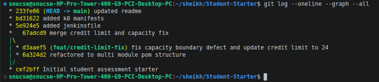
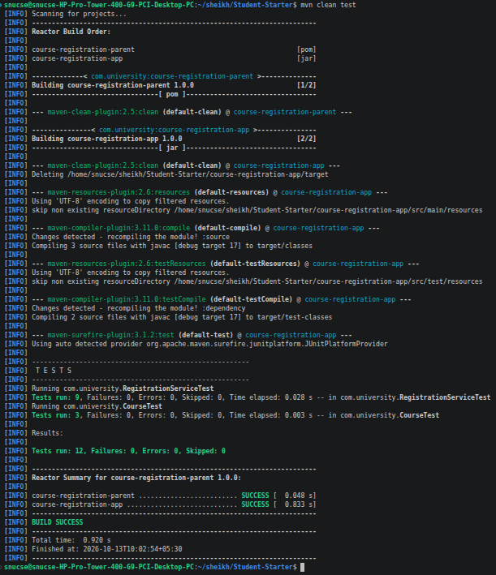
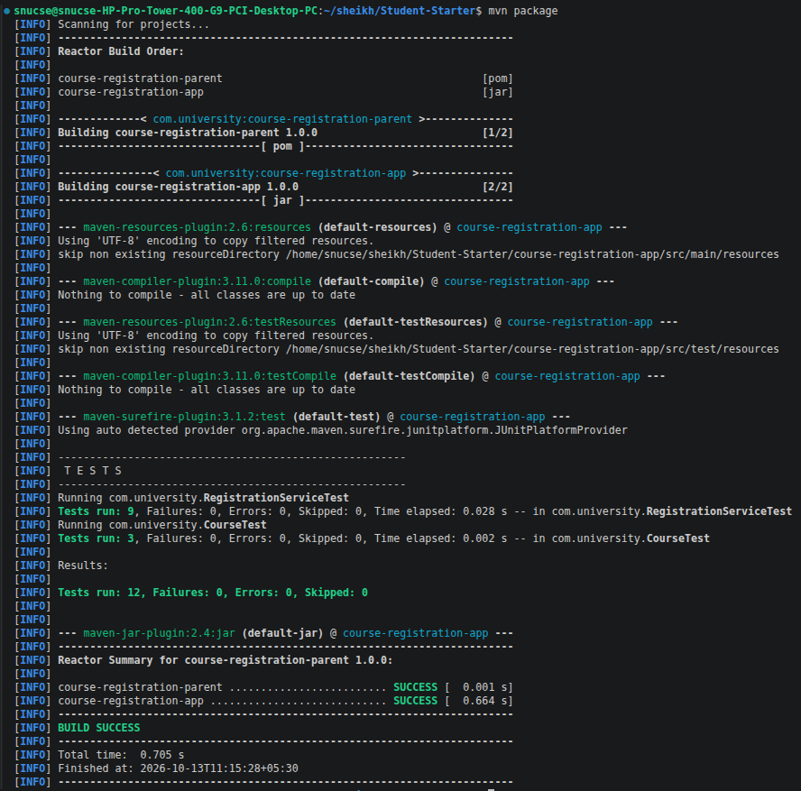
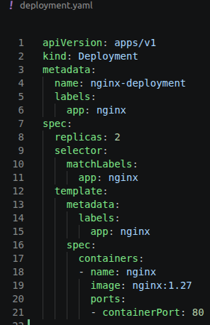
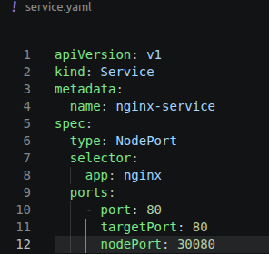
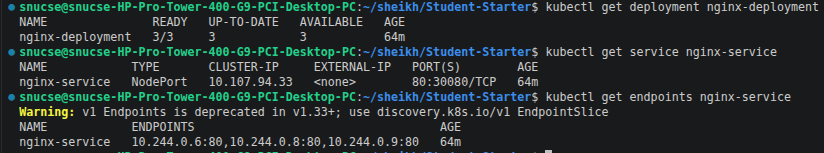
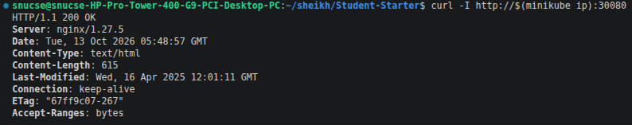
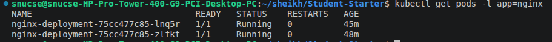
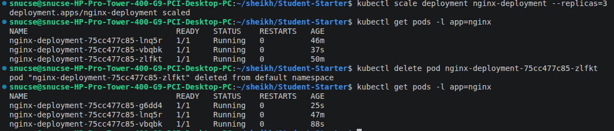

# Course Registration Service - DevOps Evaluation

## 1. Setup and Execution
```bash
mvn clean test
mvn package
minikube start
kubectl apply -f deployment.yaml
kubectl apply -f service.yaml
```

## 2. Git Evidence
- **Feature Branch**: `feat/credit-limit-fix`, merged into `main`
- `target/` build outputs are untracked and excluded via `.gitignore`.

Commit history:



## 3. Maven Architecture
- Parent `pom.xml` (`packaging: pom`) with child module `course-registration-app`.
- JUnit `5.10.0` and Java 17 managed in parent `<dependencyManagement>`.
- Build runs from the repository root via the Maven reactor.
- `mvn clean test`: 12 tests, 0 failures. `mvn package` produces `course-registration-app/target/course-registration-app-1.0.0.jar`.

**Maven build and test (12 tests, 0 failures)**



**Maven package (jar built, BUILD SUCCESS)**



## 4. Jenkins Pipeline
- Linux agent (`sh` steps).
- `junit 'course-registration-app/target/surefire-reports/TEST-*.xml'` in `post { always }`.
- Artifact archiving (`course-registration-app/target/*.jar`) only in `post { success }`, so failing tests block packaging/archiving.

## 5. Kubernetes Deployment
- `nginx:1.27`, 2 replicas, scaled to 3 via `kubectl scale deployment nginx-deployment --replicas=3`.
- NodePort Service on port `30080`.
- Self-healing: the Deployment controller reconciles `spec.replicas`; deleting a pod triggers automatic replacement.

**Deployment manifest**



**Service manifest**



**Deployment, Service and Endpoints (Service selects the 3 running Pods)**



**Application accessible via NodePort (HTTP 200, nginx/1.27.5)**



**Initial pods after deployment (2 replicas)**



**Scaling to 3, pod deletion and self-healing (replacement pod auto-created)**



## 6. Change Summary
- **Defect Fix**: capacity check corrected in `RegistrationService.java` (`>` to `>=`) — a full course rejects, the last seat can be filled.
- **Change Request (Set A)**: maximum credits raised from 20 to 24.
- **Modified/Created Files**: `pom.xml`, `course-registration-app/pom.xml`, `course-registration-app/src/main/java/com/university/RegistrationService.java`, `course-registration-app/src/test/java/com/university/RegistrationServiceTest.java`, `Jenkinsfile`, `deployment.yaml`, `service.yaml`, `README.md`.
- **Limitations**: Jenkins pipeline not executed on a live server (none provided); validated against the required Declarative structure. Kubernetes evidence captured on a single-node Minikube cluster.
